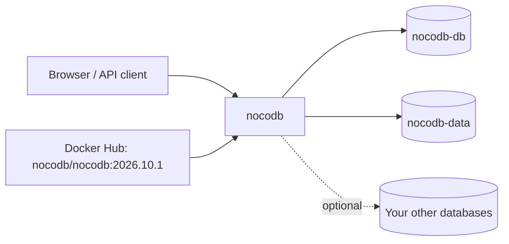

<div align="center">

# NocoDB on Render

An open source Airtable alternative. Spreadsheet views, forms, and a REST API on top of your own Postgres. This repo is the Blueprint. The app runs from the official [NocoDB](https://github.com/nocodb/nocodb) Docker image.

<p>
  <a href="https://render.com/deploy-template/api/github/start?template_repo=nocodb">
    
  </a>
</p>

<p>
  <a href="https://render.com">
    
  </a>
  <a href="https://github.com/nocodb/nocodb">
    
  </a>
  <a href="https://github.com/nocodb/nocodb/blob/develop/LICENSE.md">
    
  </a>
</p>

</div>

## What This Template Shows

This repository does not contain the NocoDB source. The service pulls the official image from Docker Hub at a pinned version. To upgrade, change the tag in [`render.yaml`](./render.yaml) and push.

| Piece | Role |
| --- | --- |
| **[NocoDB](https://github.com/nocodb/nocodb)** | Grid, gallery, kanban, form, and calendar views. REST API, webhooks, and automations. |
| **`nocodb`** ([Web Service](https://render.com/docs/web-services)) | The app and API. Runs background jobs in-process. |
| **`nocodb-db`** ([Render Postgres](https://render.com/docs/postgresql)) | NocoDB metadata and the tables you create. |
| **`nocodb-data`** ([Persistent disk](https://render.com/docs/disks)) | Uploaded attachments at `/usr/app/data`. |

## Architecture



### How It Works

1. Click **Deploy to Render**. The flow copies this repo into your GitHub account and applies [`render.yaml`](./render.yaml).
2. On Apply, enter `NC_ADMIN_EMAIL`. Render creates the database and disk and generates the admin password and encryption key.
3. NocoDB starts, migrates its metadata in Postgres, and creates the super admin from `NC_ADMIN_EMAIL` and `NC_ADMIN_PASSWORD`.
4. Copy `NC_ADMIN_PASSWORD` from the service's **Environment** page and sign in.

| Resource | Type | Plan | Notes |
| --- | --- | --- | --- |
| `nocodb` | Web, image | Standard | Disk at `/usr/app/data`, 1 GB. Health: `/api/v1/health`. Single instance. |
| `nocodb-db` | Postgres 16 | Basic 256 MB | Internal connections only. |

Default region: **Oregon**.

### Why no Redis or worker

Upstream's newer Docker Compose examples add Redis and a separate worker container. The community edition does not use them: it runs background jobs in an in-process queue. Redis only matters for multiple app instances, and a single instance keeps the attachment disk simple.

## Quick Start

1. Click **Deploy to Render** above.
2. Enter `NC_ADMIN_EMAIL`.
3. Wait until `nocodb` is **Live**.
4. Copy `NC_ADMIN_PASSWORD` from the **Environment** page and sign in at the service URL.
5. Optional: change the password in **Account settings**. The env var only creates the account on first boot.

```bash
curl -fsS "https://<nocodb>.onrender.com/api/v1/health"
```

## Configuration

| Variable | Source | Description |
| --- | --- | --- |
| `NC_ADMIN_EMAIL` | Required | Super admin email. |
| `NC_ADMIN_PASSWORD` | Generated | Super admin password for the first sign-in. |
| `NC_CONNECTION_ENCRYPT_KEY` | Generated | Encrypts credentials for external databases you connect. Do not rotate it after you add one. |
| `DATABASE_URL` | Wired | Internal URL of `nocodb-db`. |
| `NC_PUBLIC_URL` | Wired | The service's `RENDER_EXTERNAL_URL`. Used in emails, shared links, and webhooks. |
| `NC_DISABLE_TELE` | Blueprint | `true`. Turns off telemetry. |
| `NC_DISABLE_MUX` | Blueprint | `true`. Upstream's recommended setting for self-hosting. |
| `NC_SMTP_*` | Optional | Invite and password-reset emails. See [`.env.example`](./.env.example). |

`generateValue` runs once, on the first Blueprint apply. NocoDB generates its own JWT signing key and stores it in Postgres.

## Cost

Prices from [Render's pricing page](https://render.com/pricing).

| Resource | Approx. monthly |
| --- | ---: |
| `nocodb` (Standard, 2 GB) | $25 |
| `nocodb-db` (Basic 256 MB) | $6 |
| 1 GB disk | $0.25 |
| **Total** | **~$31.25** |

## Troubleshooting

| Problem | Solution |
| --- | --- |
| Admin sign-in fails | The account is created on first boot only. Use the password from the **Environment** page, or reset it from the sign-in page if SMTP is set. |
| Uploaded files disappear after a deploy | Confirm the disk is mounted at `/usr/app/data`. |
| Shared links or emails point at the wrong host | `NC_PUBLIC_URL` must be the public URL. Update it after you add a custom domain. |
| External database connections fail after a change | `NC_CONNECTION_ENCRYPT_KEY` changed. Restore the old value. |
| Deploy takes about a minute of downtime | Expected. A service with a disk stops the old instance before it starts the new one. |

## Project Structure

```
render.yaml       Blueprint. One image-backed web service, a disk, and Postgres.
README.md         This file
LICENSE           Wrapper license
.env.example      Value the deploy form asks for, and optional extras
```

## Learn More

- [Blueprint spec](https://render.com/docs/blueprint-spec)
- [NocoDB docs](https://nocodb.com/docs)
- [NocoDB on GitHub](https://github.com/nocodb/nocodb)

## License

[MIT](LICENSE) for this wrapper.

NocoDB is licensed under the [Sustainable Use License](https://github.com/nocodb/nocodb/blob/develop/LICENSE.md). You can use it for your own internal business purposes or for personal and non-commercial use. You cannot resell it or offer it to others as a paid service.
